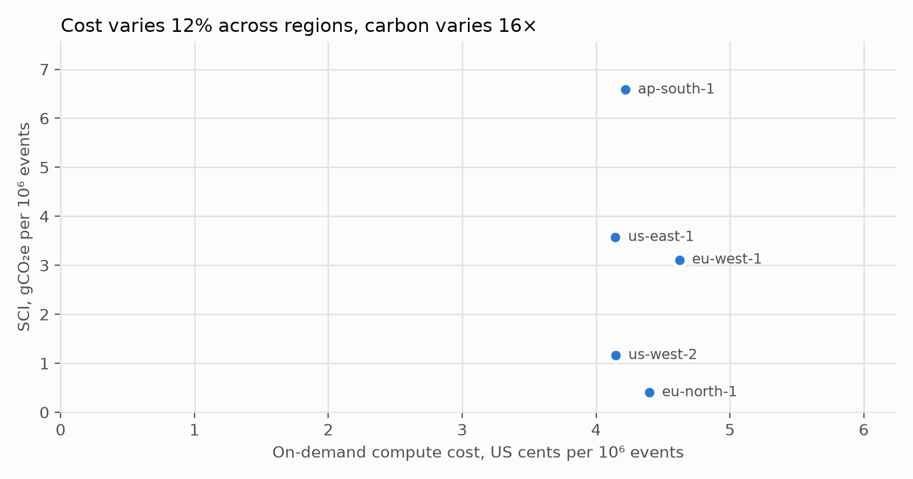
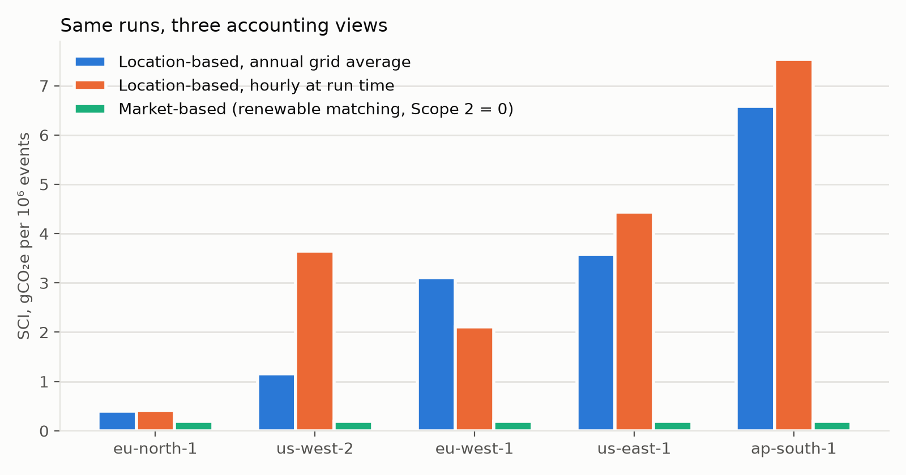
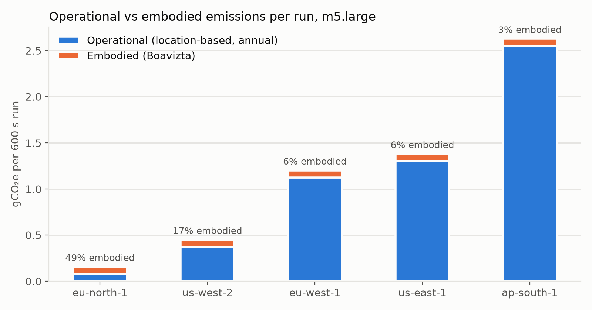
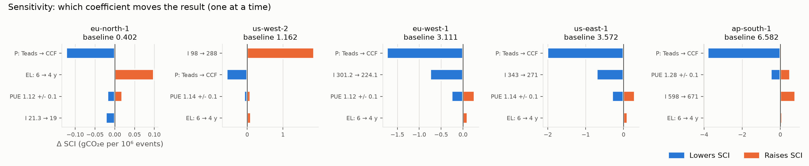
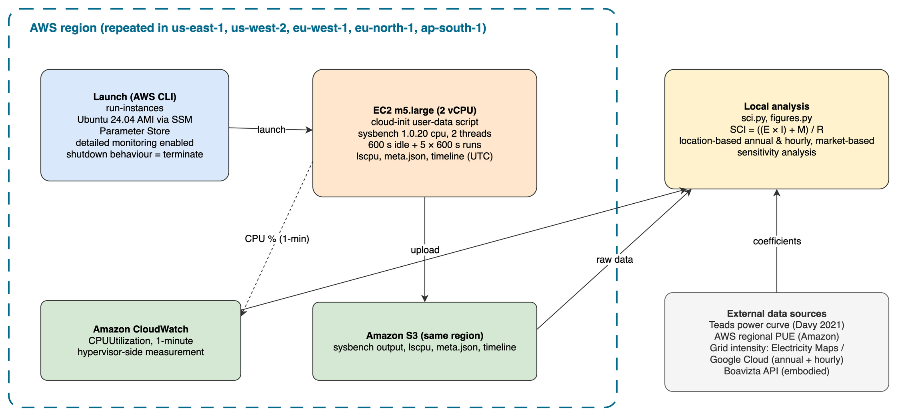

# aws-region-carbon-benchmark

[](https://github.com/bartan34/aws-region-carbon-benchmark/actions/workflows/lint.yml)

Run the same CPU-bound benchmark in several AWS regions and estimate the
lifecycle carbon footprint and the compute cost per unit of work, using the
Software Carbon Intensity (SCI) formula from ISO/IEC 21031:2024.

**Same instance type, same workload, same throughput: 16× difference in
carbon, 12% difference in cost.**



## Findings

Five regions, m5.large, 10 × 600 s sysbench cpu runs per region over two
sessions on 2026-10-11. All numbers are reproducible from `data/raw/` with
`make results`.

1. **Region choice moves carbon 16×, cost 12%.** Stockholm (eu-north-1)
   emits 0.40 gCO₂e per 10⁶ events, Mumbai (ap-south-1) 6.58, with the
   annual grid average (18× with hourly grid values). Throughput was
   about 643 events/s everywhere except one Mumbai instance. On-demand cost
   ranged from 4.14 to 4.62 US cents per 10⁶ events.
2. **On a clean grid, the hardware dominates.** In Stockholm, embodied
   emissions (manufacturing the server) are 49% of SCI. On high-carbon
   grids electricity is 94–97%. After moving to a clean region, utilisation
   and right-sizing are what is left to optimise.
3. **The accounting method can erase the difference.** Under market-based
   accounting (renewable energy matching, Scope 2 = 0), every region
   scores 0.19–0.20. A dashboard built on market-based numbers will say
   region choice does not matter; the location-based view says it is the
   biggest lever you have.
4. **When you run matters too.** In Oregon (us-west-2) the grid at run time
   was 3.6× its annual average (low autumn hydro), so SCI went from 1.16 to
   3.65. In Ireland it went the other way (3.11 → 2.10).
5. **The power model is the largest uncertainty.** Swapping the Teads
   power curve for the Cloud Carbon Footprint coefficients lowers SCI by
   30–58% in every region. For us-west-2 the grid-zone definition matters
   even more (98 vs 288 gCO₂e/kWh depending on the source).
6. **Same instance type is not the same machine.** Regions served m5.large
   on Xeon 8175M or 8259CL. Two Mumbai instances in the same AZ with the
   same CPU model ran at 643 and 669–726 events/s respectively, the faster
   one slowing run by run.



| Region | CPU | events/s ± SD | I annual (g/kWh) | SCI annual | SCI hourly | SCI market-based | Embodied share | USD/h | ¢ per 10⁶ events |
|---|---|---|---|---|---|---|---|---|---|
| eu-north-1 | 8259CL | 644.3 ± 0.4 | 21.3 | 0.40 | 0.41 | 0.20 | 48.9% | 0.102 | 4.40 |
| us-west-2 | 8175M/8259CL | 643.1 ± 1.0 | 98 | 1.16 | 3.65 | 0.20 | 17.0% | 0.096 | 4.15 |
| eu-west-1 | 8175M/8259CL | 643.0 ± 0.8 | 301.2 | 3.11 | 2.10 | 0.20 | 6.3% | 0.107 | 4.62 |
| us-east-1 | 8259CL | 643.4 ± 0.9 | 343 | 3.57 | 4.44 | 0.20 | 5.5% | 0.096 | 4.14 |
| ap-south-1 | 8175M | 666.4 ± 31.2 | 598 | 6.58 | 7.53 | 0.19 | 2.9% | 0.101 | 4.22 |

SCI in gCO₂e per 10⁶ sysbench events. Per-run values:
`data/processed/sci-results.csv`; per-region summary:
`data/processed/sci-summary.csv`; sensitivity:
`data/processed/sensitivity.csv`.





## Method

    SCI = ((E × I) + M) / R

| Term | Meaning | Where it comes from |
|---|---|---|
| E | Energy (kWh) | Measured CPU utilisation (CloudWatch, 1-min) × published per-instance power curve (Teads) × AWS regional PUE |
| I | Grid carbon intensity (gCO₂e/kWh), location-based | Electricity Maps / Google Cloud region table / Ember |
| M | Embodied emissions (gCO₂e) allocated to the run | Boavizta API |
| R | Functional unit | 10⁶ sysbench events |

Why estimate instead of measure: EC2 virtual machines do not expose RAPL
power counters, so every published cloud-carbon method (Teads, Cloud Carbon
Footprint, Boavizta, Dodge et al. 2022) models power from utilisation.
This repo makes that model explicit, parametric and reproducible.

Three accounting views are computed side by side: location-based with the
annual grid average, location-based with the grid intensity at run time,
and market-based. Cost is on-demand Linux compute for the run duration
(per-second billing), from the AWS Price List API.

## Architecture



Each region runs the same sequence: `launch.sh` creates a same-region S3
bucket and an EC2 instance whose user-data installs sysbench, records an
idle baseline and the runs, uploads the outputs and shuts the instance
down. CloudWatch records 1-minute CPU utilisation in the meantime.
`pull-cloudwatch.sh` brings both back to `data/raw/`, and `analysis/`
turns them into results and figures. The editable diagram source is
`docs/architecture.drawio`.

The same run is available as Terraform (`infra/`) and as a GitHub Actions
workflow that applies, waits, collects the data and destroys, one job per
region. See [docs/terraform.md](docs/terraform.md).

Guardrails:

- **No stored AWS keys in CI.** GitHub Actions assumes an IAM role through
  OIDC; only workflows on `main` of this repository can assume it, and the
  role can launch only allowed instance types in allowed regions, and
  touch only resources tagged `Project=carbon-bench`.
- **No access from outside.** No key pair, no SSH; the instance role has
  `s3:PutObject` on `carbon-bench-*` buckets only, plus SSM for emergency
  access (`docs/iam-policy.json`, `docs/iam-setup.md`).
- **IMDSv2 required** (`--metadata-options HttpTokens=required`).
- **Cannot be forgotten.** Instances launch with
  `--instance-initiated-shutdown-behavior terminate` and shut themselves
  down after uploading. `cleanup.sh` lists instances tagged
  `Project=carbon-bench`, unattached volumes, Elastic IPs, project
  security groups and buckets; `--delete` removes all but the instances.
  In the Terraform path `terraform destroy` runs even when a step fails.
- **No cross-region traffic.** Outputs go to a bucket in the same region.
- **Budget alarm first.** The quick start asks for an AWS Budget before
  anything is launched.

## Quick start

Two equivalent paths: the shell scripts below, or Terraform and GitHub
Actions ([docs/terraform.md](docs/terraform.md)).

Prerequisites: AWS CLI v2 configured, `jq`, Python 3.10+, an IAM instance
profile named `carbon-bench-ec2-role` (see `docs/iam-setup.md`), and an
AWS Budget alarm. Set one up before launching anything.

```bash
# 1. Pilot: one region, 2-minute runs, confirm the pipeline end to end
./scripts/launch.sh us-east-1 m5.large 1 120 60

# 2. Full run: 5 × 10-min runs + 10-min idle baseline, per region
for r in us-east-1 us-west-2 eu-west-1 eu-north-1 ap-south-1; do
  ./scripts/launch.sh $r m5.large 5 600 600
done

# 3. After each instance reports done_utc in S3 (≈70 min), pull outputs and metrics
./scripts/pull-cloudwatch.sh us-east-1 i-0123456789abcdef0 carbon-bench-us-east-1-XXXX

# 4. Embodied emissions per country (ISO3) and run length in hours
./scripts/boavizta.sh m5.large USA 0.1667

# 5. On-demand prices for every region in regions.csv
./scripts/pricing.sh m5.large

# 6. Results and figures
pip install -r requirements.txt
make results

# 7. Confirm nothing is left behind
./scripts/cleanup.sh us-east-1 --delete
```

### Reproducing the published numbers

No AWS account needed: every raw output and coefficient is committed.

```bash
pip install -r requirements.txt
make check   # regenerates results and figures, fails if any number in data/processed differs
```

`analysis/sci.py` uses only the standard library; `analysis/figures.py`
needs matplotlib.

## Repository layout

```
scripts/            launch, user-data (benchmark), wait, metric pull, Boavizta, pricing, cleanup
infra/bootstrap/    Terraform: state bucket, instance role, GitHub OIDC role, budget
infra/benchmark/    Terraform: one region's bucket, security group and instance
.github/workflows/  benchmark (run from the Actions tab), lint and reproduction checks
data/coefficients/  every external number with source, year, access date
data/raw/<region>/  per-instance outputs: sysbench, lscpu, meta.json, cloudwatch.csv
data/raw/_pilot/    2-minute pilot run, excluded from the analysis
data/processed/     sci-results.csv, sci-summary.csv, sensitivity.csv
analysis/           sci.py (computation), figures.py (sensitivity and figures)
docs/               IAM policy, architecture diagram, figures
```

## Design choices

- **m5.large**: non-burstable (T-series credit/boost behaviour distorts
  runtime), measured in the Teads dataset, present in Boavizta.
- **sysbench cpu**: deterministic prime search, reports events/s, which
  becomes the functional unit R. Integer workload; power at 100% is an
  upper-bound estimate.
- **Ubuntu 24.04** via SSM Parameter Store: identical AMI in every region.
- **Two sessions, seven hours apart**, to see time-of-day variation in
  the grid without changing anything else.
- **UTC everywhere**, 1-minute CloudWatch detailed monitoring, lscpu saved
  per instance to detect CPU-model variation across regions.

## Assumptions and limitations

- Power is modelled, not measured; Teads data dates from 2021.
- PUE is AWS's published regional average, not per data centre.
- Grid intensity zone mapping is approximate for us-west-2 and ap-south-1.
- Hourly grid values are point readings at run time, not a full history.
- Boavizta covers the server share only (no network, storage, building).
- Cost covers on-demand compute only (no EBS, S3, CloudWatch, Savings
  Plans or Spot).
- One CPU-bound workload and one instance type; results do not transfer
  to memory/IO-bound jobs or other instance families.
- Data-transfer and latency costs of actually moving a workload are out
  of scope (see Sukprasert et al. 2024).

## Coefficient sources

See `data/coefficients/*.csv`; each row carries source URL, year and
access date. Primary sources: Davy (2021, Teads EC2 dataset), Cloud Carbon
Footprint methodology, Boavizta API, Amazon AWS sustainability page (PUE),
Google Cloud region carbon table, Electricity Maps Grid in Review 2025,
AWS Price List API, ISO/IEC 21031:2024.

## Citing

See `CITATION.cff`, or use GitHub's "Cite this repository" button.

## Licence

Code: MIT. Data under `data/`: CC BY 4.0 (compatible with the Teads
dataset licence). See `LICENSE` and `data/LICENSE`.

## Origin

Started as coursework for a cloud architecture module (TU Dublin, 2026),
answering "How do regions differ in carbon emissions for the same
workload?". The tool is general; the coursework write-up is not part of
this repository.
